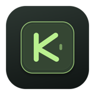

# Keynest

**Find your focus. / Encontre seu foco.**



Keyboard sounds, ambient audio and a Pomodoro timer in one native macOS app.
Built with SwiftUI, with Portuguese and English support.

**[Download for macOS](https://github.com/luiizHenCode/keynest/releases/latest)** · [All releases](https://github.com/luiizHenCode/keynest/releases) · [Report an issue](https://github.com/luiizHenCode/keynest/issues)

**Requirements:** Apple Silicon (M1 or later), macOS 14 Sonoma or later. The official release is Developer ID signed and notarized by Apple.

## Features

- **Keyboard sounds:** real Cherry MX Black, Brown and Blue recordings, with independent volume and sound previews.
- **Ambient audio:** rain, ocean, forest and lo-fi tracks included for offline playback.
- **Pomodoro:** configurable focus and break durations, finite or unlimited cycles, manual or automatic transitions, sound alerts and optional notifications.
- **Live timer:** choose a draggable floating panel with a keep-on-top option, or a countdown in the menu bar.
- **Menu bar controls:** keep audio and timers running with the settings window closed.
- **Languages:** switch between Portuguese, English and the system language without restarting.

## Install

1. Download the DMG from [Releases](https://github.com/luiizHenCode/keynest/releases/latest).
2. Open it and drag **Keynest** to **Applications**.
3. Open Keynest from Applications.
4. To hear keyboard sounds in other apps, enable **Keynest** in **System Settings → Privacy & Security → Input Monitoring**. Quit and reopen if macOS requests it.

Pomodoro notifications require a separate notification permission. Ambient audio and the keyboard test field work without Input Monitoring permission.

The release includes a `.sha256` file. With both files in the same folder, verify the download using:

```sh
shasum -a 256 -c Keynest-1.0.0-arm64.dmg.sha256
```

## Em português

O Keynest reúne sons de teclado, ambientes sonoros e sessões de foco em um app nativo para macOS.

### Instalação

1. Baixe o DMG em [Releases](https://github.com/luiizHenCode/keynest/releases/latest).
2. Abra o arquivo e arraste **Keynest** para **Aplicativos**.
3. Abra o app pela pasta Aplicativos.
4. Para ouvir os cliques em outros apps, autorize o Keynest em **Ajustes do Sistema → Privacidade e Segurança → Monitoramento de Entrada**. Se solicitado, encerre e reabra o app.

As notificações do Pomodoro têm uma autorização separada. O ambiente sonoro e o campo de teste não precisam da permissão de monitoramento.

### Como usar

- **Teclado:** escolha um dos três modelos Cherry MX, ouça a prévia e ajuste o volume.
- **Ambiente:** escolha entre Chuva, Oceano, Floresta ou Lo-fi. O volume e a ativação são independentes dos cliques.
- **Pomodoro:** configure o tempo de foco, intervalo e quantidade de ciclos em **Ajustar sessão**. Cada ciclo inclui foco e intervalo, inclusive o último. É possível pausar, retomar e pular intervalos.
- **Modo live:** acompanhe o tempo no painel flutuante ou na barra de menus. O painel pode ser arrastado pelo cabeçalho e fixado sobre outras janelas.
- **Idioma:** escolha Sistema, Português ou English nos ajustes ou pelo menu da barra superior.

Fechar a janela mantém o app funcionando na barra de menus. Para parar o áudio e encerrar o processo, escolha **Encerrar Keynest** nesse menu.

## Privacy / Privacidade

Audio is bundled with the app and plays locally, without streaming. The keyboard listener detects key presses without extracting or storing the characters typed in other apps. The test field holds only its own text temporarily in memory and does not save it.

Os áudios estão incluídos no app e são reproduzidos localmente, sem streaming. O monitoramento detecta toques sem extrair ou armazenar os caracteres digitados em outros apps. O campo de teste mantém apenas seu próprio texto temporariamente em memória, sem salvá-lo.

## Limitations / Limitações

- This release supports Apple Silicon only; an Intel build is not currently available.
- Password fields and apps using Secure Input may block global keyboard sounds.
- Bluetooth audio devices may introduce latency.
- Pomodoro preferences are saved, but active sessions are not restored after quitting the app.
- Sleep time counts toward the Pomodoro. Alerts cannot be guaranteed while the Mac is asleep.
- Notification delivery follows macOS notification and Focus settings.

## Build from source

Requires Xcode command-line tools and Swift 6 or later.

```sh
swift test
sh scripts/build-app.sh
open build/Keynest.app
```

Local builds use ad-hoc signing. The bundled app is recommended over `swift run MacTap` when testing macOS permissions. The Swift package and internal executable are named `MacTap`.

To create a local installer:

```sh
sh scripts/build-dmg.sh
```

## License and audio credits

The original Keynest code is available under the [MIT License](LICENSE).
Third-party audio retains its own license and attribution requirements:

- [Keyboard recordings](THIRD_PARTY_NOTICES.md) — MIT.
- [Rain](AMBIENCE_NOTICES.md) — CC BY 4.0.
- [Ocean and forest](NATURE_NOTICES.md) — CC BY 4.0 and CC0.
- [Lo-fi music](LOFI_NOTICES.md) — CC0.

Audio credits and license links are also included in the app.
